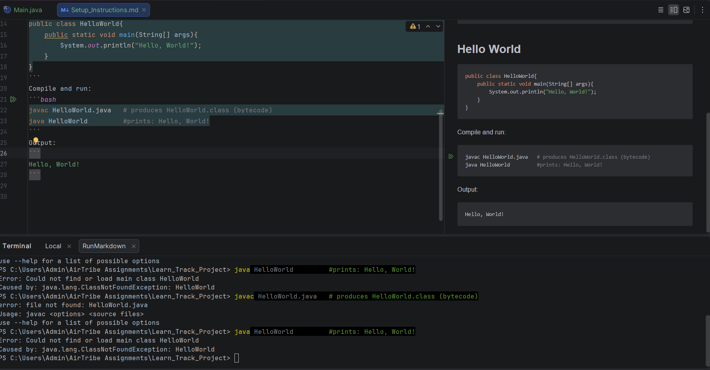

# Setup Instructions

## JDK version used
Oracle Openjdk 27

## Verify installation
```bash
java -version
javac -version
```

## Hello World
```java
public class HelloWorld{
    public static void main(String[] args){
        System.out.println("Hello, World!");
    }
}
```
Compile and run:
```bash
javac HelloWorld.java   # produces HelloWorld.class (bytecode)
java HelloWorld         #prints: Hello, World!
```
Output:
```
Hello, World!
```


